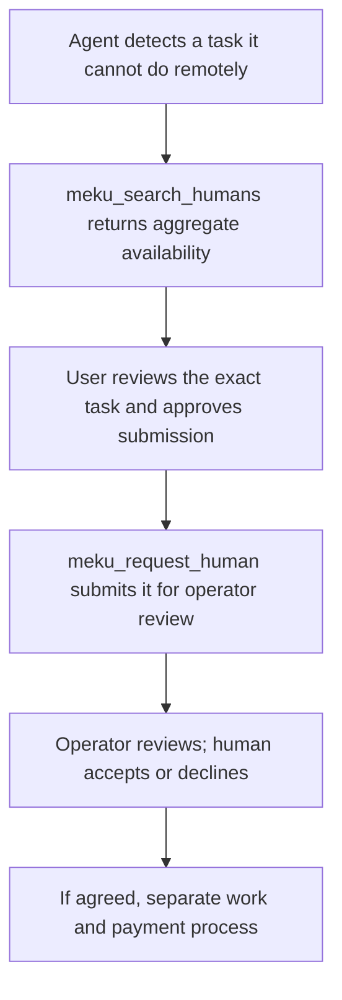

# A Human Cloud task: simulated example

> **Simulation only.** This walkthrough uses invented example values. It does not submit a MEKU request, contact a person, record work, or send payment.

## The task

A user asks an AI agent: “Find the opening hours posted on the public notice board at the Northside Library entrance.” The agent can search online but cannot visit the entrance or take a photo. It needs help from a person who may choose whether to accept.

## The flow

1. **Search availability.** The agent calls **meku_search_humans** with a relevant skill such as photography. MEKU returns aggregate availability counts, not names or guarantees that anyone will accept.
2. **Prepare a clear request.** The agent drafts a narrow task: visit the named public location during opening hours, photograph only the public hours notice, and return a transcription. It excludes photographing people and asks the user to review the task details.
3. **Ask the user.** Before a write call, the agent shows the task, location, deliverable, timing, and any proposed budget. The user must explicitly approve sending the request. If the user declines, the workflow stops.
4. **Submit for operator review.** Only after user approval does the agent call **meku_request_human**. A real receipt means only “submitted”; MEKU's operator reviews it next.
5. **Human choice and later work.** If the operator approves the request, a person can accept or decline. The three MCP tools do not record acceptance, verify completion, or make payment. Any paid mission must follow MEKU's separate documented process, with the person agreeing to its terms before work starts.

## Example requests and responses (simulated)

Read-only search request:

~~~json
{
  "name": "meku_search_humans",
  "arguments": {"skills": ["photography"]}
}
~~~

Simulated search result:

~~~json
{
  "listed_humans": 8,
  "online_humans": 6,
  "matching_humans": 2,
  "matched_skills": ["photography"],
  "note": "SIMULATED VALUES — not a live MEKU response"
}
~~~

After a separate user approval, the write request could be:

~~~json
{
  "name": "meku_request_human",
  "arguments": {
    "title": "Photograph the public library hours notice",
    "action": "Visit the public entrance and photograph the posted hours notice",
    "description": "At Northside Library, photograph only the public opening-hours notice at the entrance and transcribe the hours shown. Do not photograph people or private information.",
    "skills": ["photography", "transcription"],
    "deliverable": "One image of the public hours notice and a plain-text transcription",
    "timeframe": "Before the user's stated deadline"
  }
}
~~~

Simulated submission receipt:

~~~json
{
  "id": "SIMULATED-REQUEST-ID",
  "status": "submitted",
  "note": "SIMULATED — no request was sent to MEKU"
}
~~~

A real **meku_request_human** receipt is not operator approval, a human acceptance, completed work, or payment. Check status with **meku_get_request_status** using the same API key that submitted the request. Status lookup is also not proof of completion or payment.

## What this example teaches

- The search tool helps an agent decide whether to propose human help; it cannot promise a worker.
- The agent should request user approval before using the write tool.
- MEKU operator review and the person's choice are separate steps.
- An approved request does not mean the person accepted or completed the task.
- Payment is outside the three MCP tools and is not demonstrated here.

See the [MCP reference](mcp-reference.md), [security and consent](security-and-consent.md), and [independent pilot guide](first-pilot.md) before building a client.
